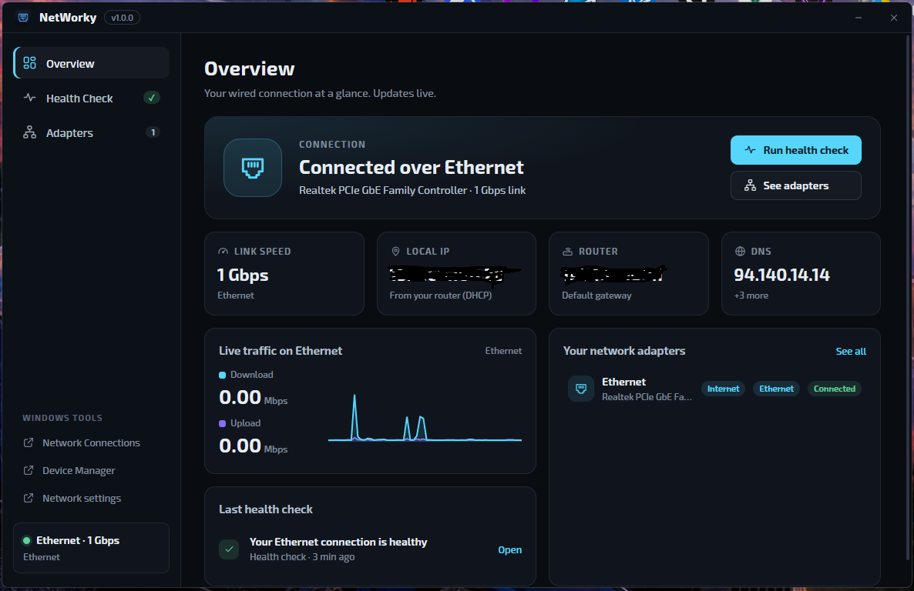
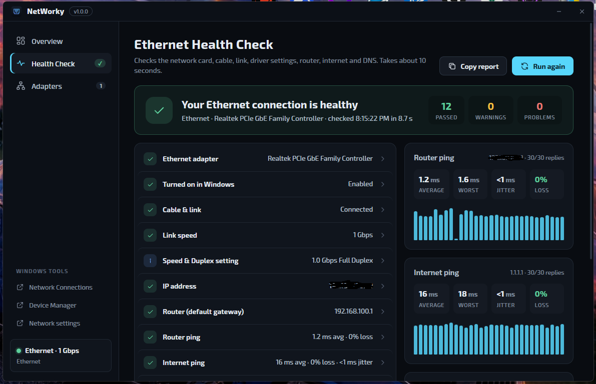
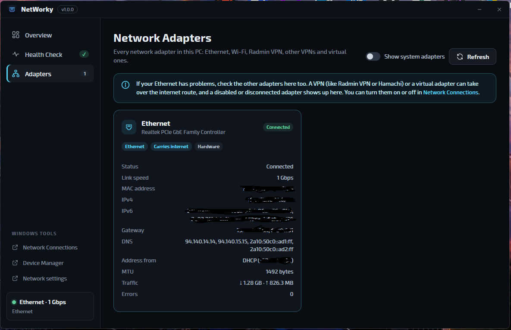

# NetWorky

**Is your Ethernet working properly?** NetWorky is a small Windows app that checks the health of your wired (Ethernet) network adapter and shows every network adapter in your PC.

> NetWorky checks **wired Ethernet only**. Wi-Fi health checks are not supported: if you're on Wi-Fi, NetWorky tells you so.

## Download

Get **NetWorky.exe** from the [latest release](https://github.com/CazymirTM/NetWorky/releases/latest). Nothing to install: just run it.

- Windows 10 or 11, 64-bit
- No admin rights needed
- Uses Microsoft Edge WebView2, which is already part of Windows 10/11

Windows SmartScreen may warn about a new, unsigned app. Click **More info → Run anyway**.

## What it does

### Ethernet health check (about 10 seconds)
| Check | What it tells you |
|---|---|
| Network card & driver | Your wired card is found, with driver version and date |
| Turned on in Windows | The adapter isn't disabled |
| Cable & link | The card sees a live cable |
| Link speed | 1 Gbps or more is good; 100 Mbps on a gigabit card usually means a damaged or Cat5 cable or a slow router port |
| Speed & Duplex | Auto Negotiation, or a fixed/half-duplex setting that can slow you down |
| IP address | Your router gave you an address (catches the 169.254.x.x DHCP failure) |
| Router (default gateway) | Windows knows where to send internet traffic |
| Router ping | 30 pings over the cable: packet loss, latency, jitter |
| Internet ping | 30 pings to 1.1.1.1 sent from the Ethernet adapter |
| DNS | Website names are found, and how quickly |
| Transmission errors | Damaged packets counted by the card (a bad cable or port) |
| Power saving | Energy-Efficient Ethernet, Green Ethernet and similar features that can cause drops |
| Packet size (MTU) | Standard 1500, PPPoE 1492, jumbo frames |
| Internet route | Your internet really goes through the cable (not Wi-Fi or a VPN) |
| Other adapters | Other active adapters that could take over |

Every result comes with a plain explanation and what to do about it. **Copy report** puts the whole result on the clipboard, ready to paste when asking for help.

### Adapters
Every network adapter in the PC: Ethernet, Wi-Fi, **Radmin VPN**, other VPNs (Hamachi, OpenVPN/TAP, WireGuard, Tailscale, ZeroTier...), virtual adapters (Hyper-V, WSL, VirtualBox, VMware) and more, with status, link speed, MAC, IPv4/IPv6, gateway, DNS, DHCP, traffic and errors. Turn on **Show system adapters** to also see Windows' internal ones.

### Overview
Live connection status, link speed, local IP, router, DNS, live traffic on the Ethernet adapter, and your last health check.

## Privacy

NetWorky only reads information from Windows and never changes any setting. It connects to:
- `1.1.1.1` (ping) and a few well-known websites (DNS lookup), only during a health check
- `api.github.com`, at startup, to see if a newer NetWorky is available (it never downloads anything by itself)

No data is collected or sent anywhere else.

---
Made by CeZeY22.
